<div align="center">


# SIXFINGERS

A laundromat for prompts. You write one, pick a washing machine, and six pictures come out of the door.

**[sixfingers.art](https://sixfingers.art)**

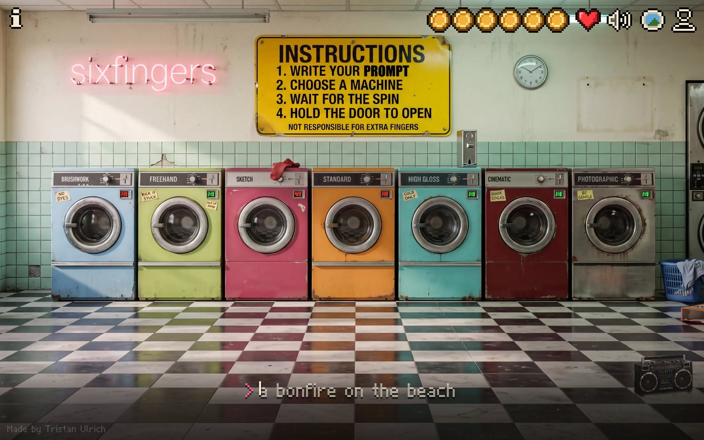

</div>

## What it is

SIXFINGERS is a small website that makes pictures with AI image models. It is dressed as one wall of an old laundromat. There are seven machines, and each one runs a different model. You write a prompt on the floor (the sentence you give the model), drop a coin in a machine, and your words get pulled in and washed. When the machine beeps you hold the door until it bursts, and six pictures come out.

It's free and you don't sign up for anything. The pictures come from the [AI Horde](https://aihorde.net), a network of people who lend their graphics cards to strangers for free.

I'm Tristan Ulrich, a student in Paris, and I make it on my own.

## Why it exists

Image models are bad at hands. Ask one for a person waving and there is a fair chance the hand comes back with six fingers, or four, or a thumb on the wrong side. Stable Diffusion 1.5, the model behind the orange machine in the middle, was the first one that most people could run, and it gets the composition of a picture right while getting the anatomy wrong. That is where the name comes from. The sign on the wall says so too: "Not responsible for extra fingers."

A free model on volunteer computers can take a minute, sometimes several, and most sites cover that with a spinner. I wanted the wait to be the part you enjoy. A laundromat is a room built for waiting: you put something in, you watch it go round, and you get your things back a little changed. Words going into a machine and coming back as six pictures felt like a fair description of what these models do.

The first version of the site, from August to October 2026, was dressed as Windows XP, and six pictures arrived as a "pack" you opened by knocking on it. The laundromat replaced it on 12 October 2026.

## How a wash goes

**Pick a machine.** Clicking a machine walks you up to it. Its card says which model it runs and what that model is good at, then three numbers: "wait", how long a wash would take if you started now; "ahead", how many requests are already waiting for this machine; and "helpers", how many volunteer computers are running its model right now.

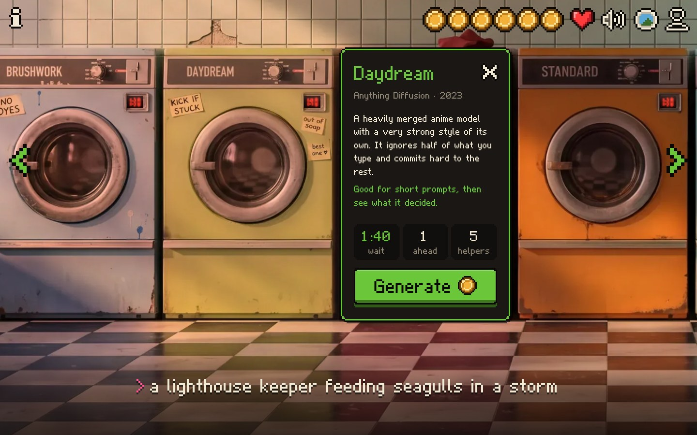

**Drop a coin.** The coin goes into the slot, the door swings open and the letters of your prompt fly in one at a time.

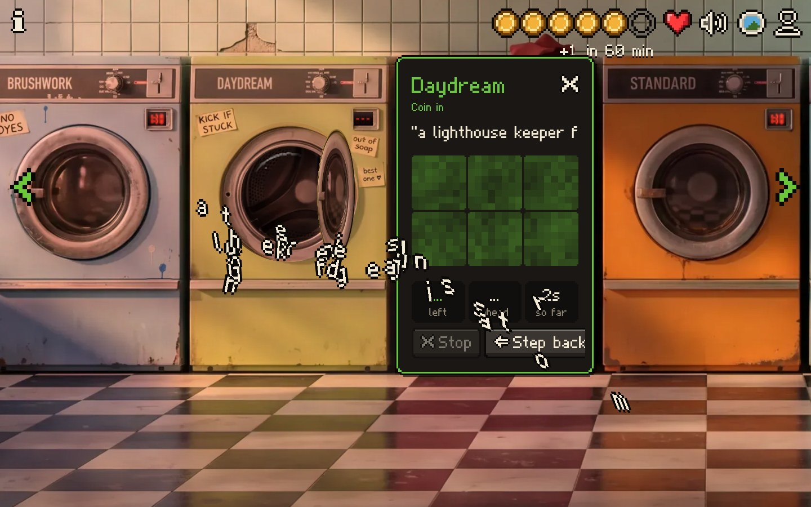

**Wait in line.** The red display on the machine becomes a countdown, like a real one, and the card shows the same number. It only ever goes down, one second per second. The drum runs a programme picked at random for each wash: turns one way then the other, rocking, short shakes, pauses, and quick bursts of spin that pin the letters to the wall before letting them drop.

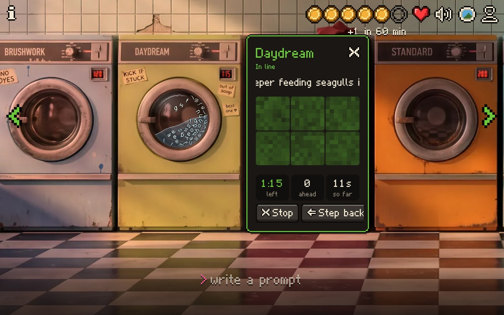

**Your turn.** When a volunteer picks up your prompt, the machine chimes and says so. From there the time is ours: the six pictures appear one by one in the squares as they really finish, the drum rinses, drains and spins, and the countdown reaches 0:00 exactly when the machine stops.

You don't have to stand there. Up to three machines can wash at once, one coin each, and you can walk between them; a machine that finishes while you're elsewhere lights up and beeps.

**Hold the door.** When the machine is done it glows. You press and hold on it, the drum rumbles, steam hisses through the seal, and the door blows open.

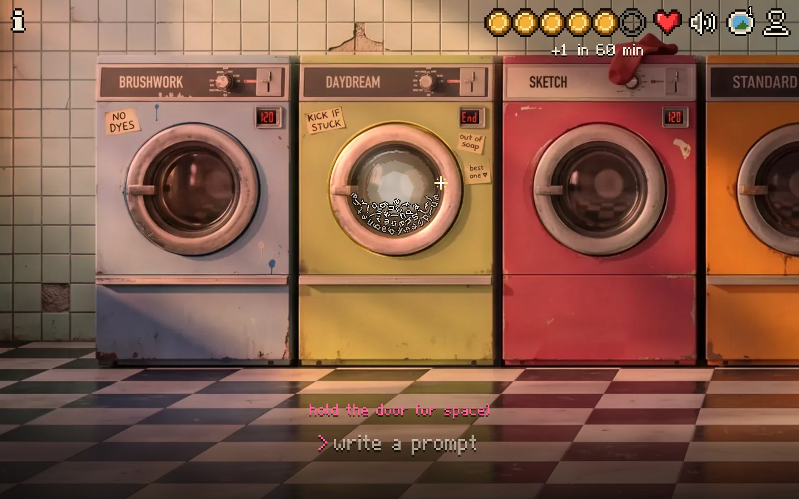

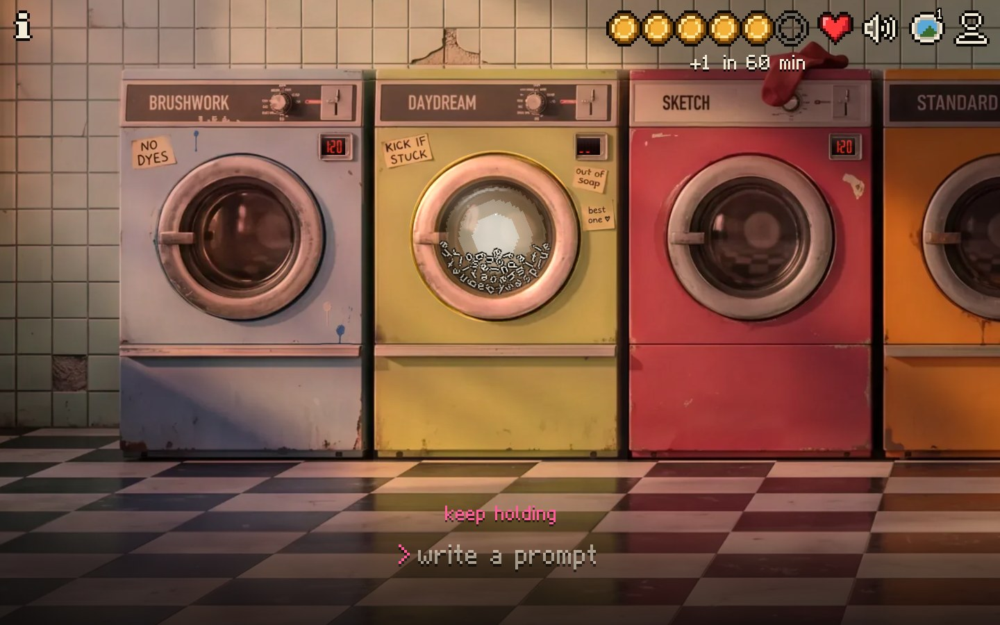

**Six pictures come out,** one at a time. You can keep them, share them, love them, or wash the same prompt in another machine.

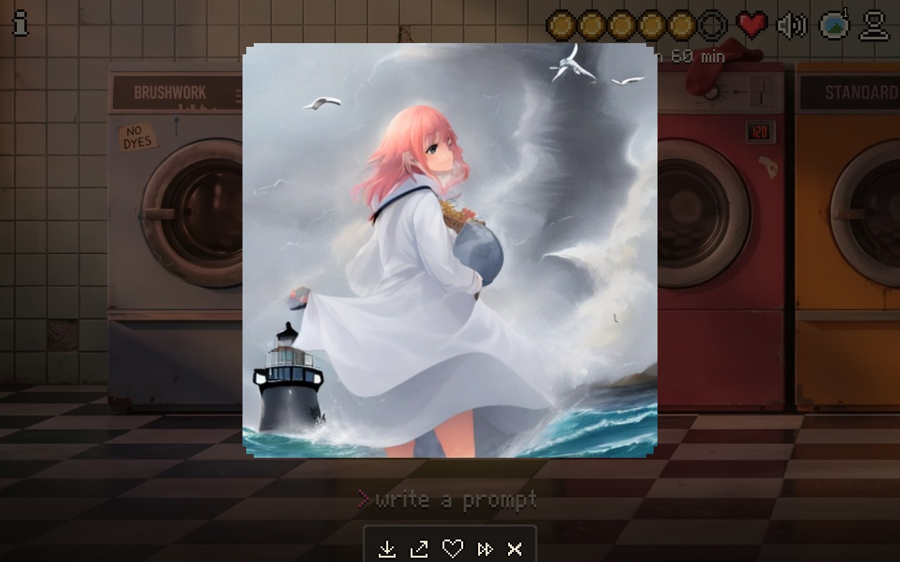

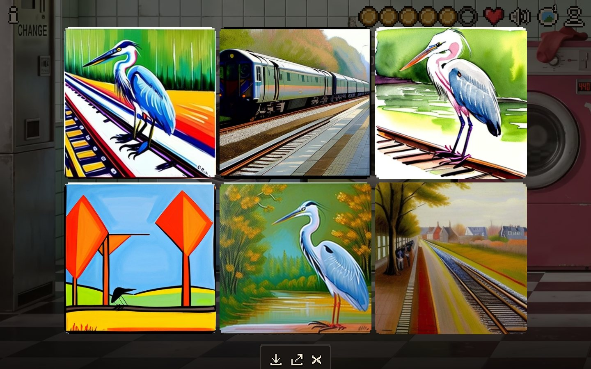

Those six are a real wash on the Daydream machine with the prompt "a lighthouse keeper feeding seagulls in a storm", made for this page on 19 October 2026.

The collection keeps every wash with its prompt, its machine and its date, in your browser. You can sign in with Google or GitHub (accounts run on Supabase, hosted in Paris) so that a collection follows you from one device to another. Signing in is optional.

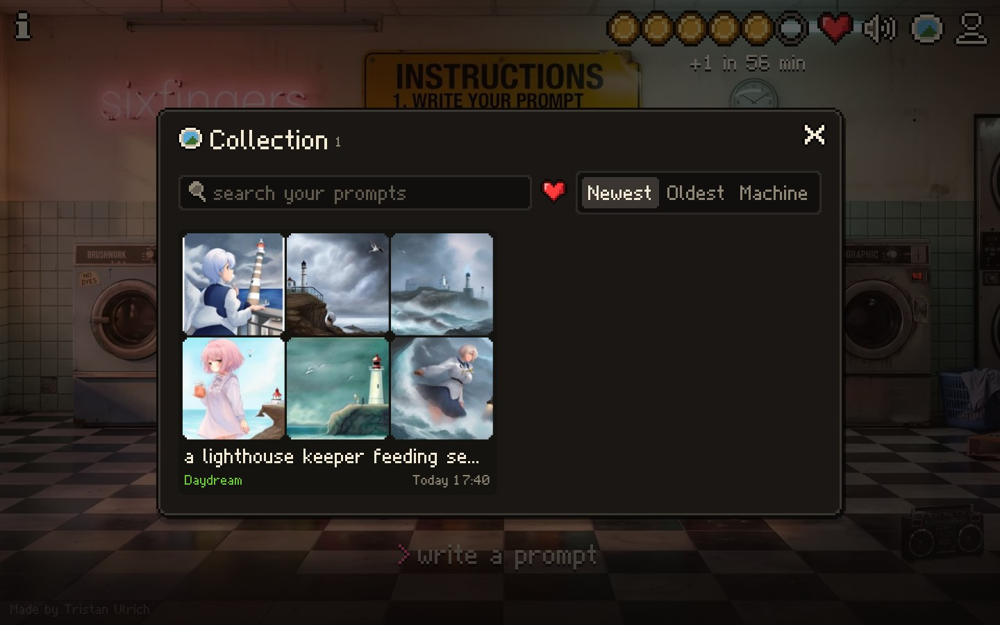

## The room changes with the time

The light coming into the room follows your own clock: daylight, sunset, and night with the neon doing most of the work.

<table>
<tr>
<td>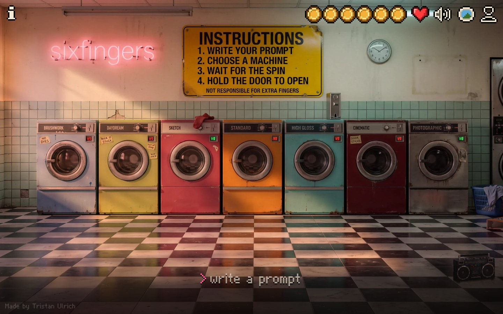</td>
<td>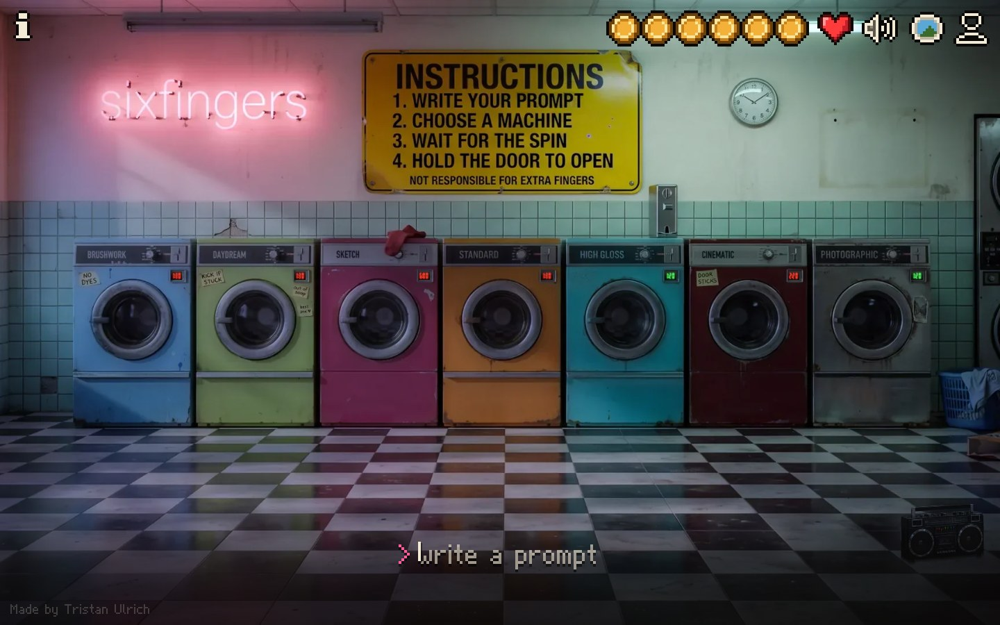</td>
</tr>
</table>

It also works on a phone and a tablet: the machine stands under the icons, its card sits underneath at a fixed size, you swipe or tap the arrows to go from one machine to the next, the pages take the whole screen, and the prompt moves above the keyboard.

<table>
<tr>
<td>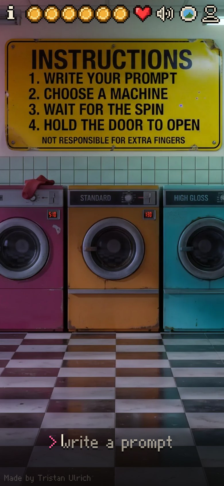</td>
<td>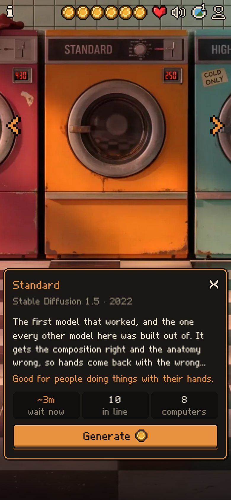</td>
<td>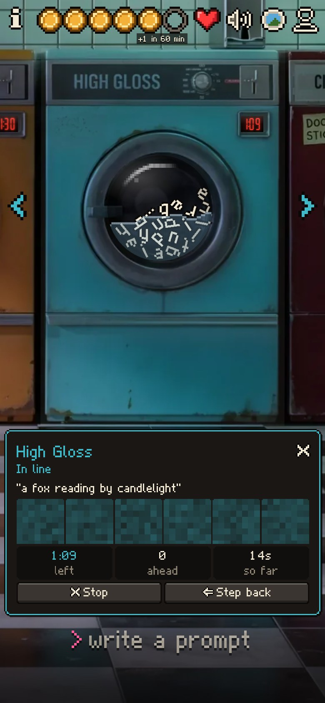</td>
<td>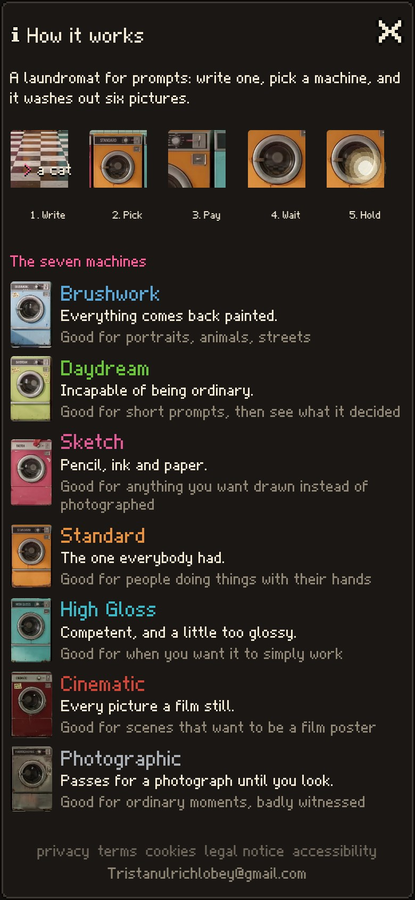</td>
</tr>
</table>

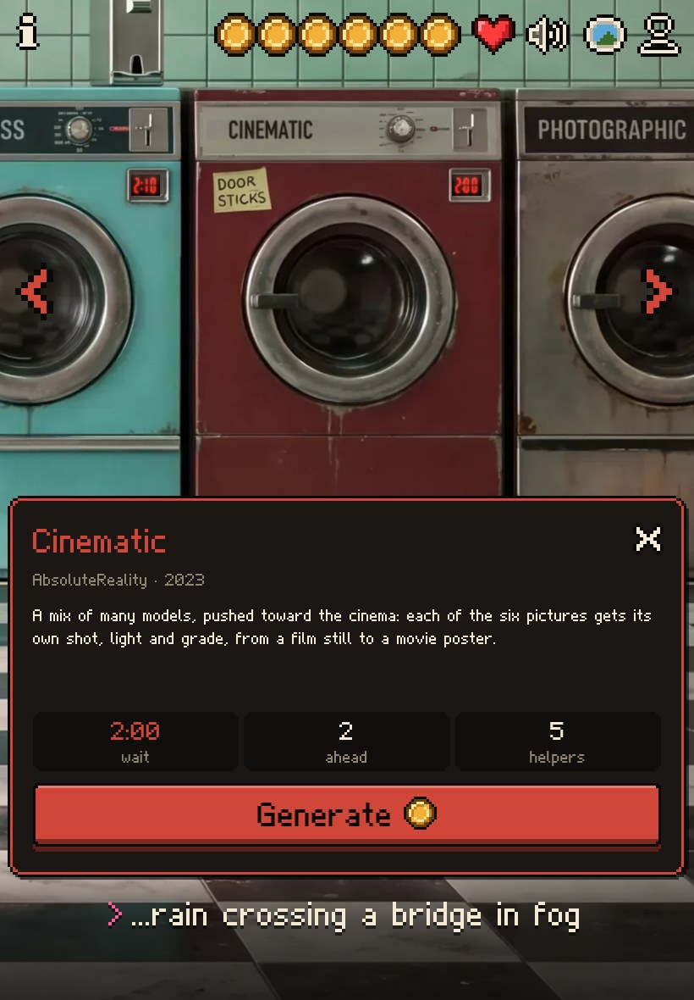

## The seven machines

From left to right on the wall. Each machine adds a "recipe" to your prompt: a few words of style, plus a list of things the picture should avoid. A machine doesn't have one fixed recipe. It has a small library sorted along a few axes (technique, light, colour), and for each wash every axis is shuffled like a deck of cards, so the six pictures each get a different combination and two washes of the same prompt don't come out alike.

| Machine | Model | What it does |
|---|---|---|
| Brushwork | Deliberate | Paints everything. Each picture gets its own technique (oil with thick impasto, watercolour, gouache, impressionist, Dutch golden age, acrylic), its own brushwork and its own palette. |
| Daydream | Anything Diffusion | A strong anime style that ignores half of what you type, and the regulars' favourite (there's a note on it that says so). The recipe moves between cel shading, manga panels, chibi and 1990s anime stills. |
| Sketch | Anything V5 | Pencil, ink and paper: graphite, pen, charcoal, ink wash, clean lineart. One picture in six keeps a little watercolour, because six black and white faces in a row felt grim. |
| Standard | Stable Diffusion 1.5 | No recipe at all. Your prompt goes in as you typed it. This is the model everything else here was built from, and the one with the most extra fingers. |
| High Gloss | Dreamshaper | The most capable and the least surprising. Concept art, glossy renders, storybook illustration, studio light. |
| Cinematic | AbsoluteReality | Every picture is a film still or a poster: its own shot, its own light (rim light, golden hour, a single hard lamp) and its own colour grade. |
| Photographic | ICBINP ("I Can't Believe It's Not Photography") | No recipe. It looks like a real camera took it, right up until you look at the hands. |

I picked the models with a stopwatch. On 12 October 2026 I sent the same prompt to eight models at the same time and kept the ones that came back in a reasonable time; two machines changed model that evening because almost nobody was running their old one.

## How the wait is estimated

This took four tries, and the fourth is the one worth describing.

What the real washes showed, once they were recorded: a wash is two very different waits. First the line, until a volunteer picks up the request. Then the work, which is short: the six pictures of a wash usually come back within 12 to 33 seconds of each other. The line is the long and unpredictable part. And it follows one thing far better than anything else: how many requests are already waiting for that particular model. The Horde's overall queue (often 600 or 700 requests) said almost nothing, because each computer only serves the models it has loaded.

So a machine announces:

```
line  = (10 s + 7 s per request waiting for this model) x a learned margin x 1.15 + 10 s
ritual = the time this machine usually needs to finish six pictures, + 8 s, + 12 s of spin (35 to 70 s)
wait   = line + ritual
```

The learned margin comes from every wash anyone has done on that machine in the last two weeks (its 30 most recent): the 85th percentile of how long the line really took compared to the rule, so that the announced time is one you will almost never go over. With few measurements it leans towards a cautious default.

During the wash, the countdown follows two rules.

- **In line, it only goes down.** If a volunteer picks you up early, the ritual takes what was left (up to 75 seconds), so the clock usually doesn't even jump: it keeps going down and reaches zero when the machine stops. If the line is slower than announced, the ritual can shrink to 35 seconds to absorb it.
- **If that is not enough, it says so.** The card reads "small delay: +30s", then "+60s" at most, never more than twice. Tapping the line explains it in full.
- **One big honest correction.** The real washes showed where the rule breaks: a machine with only two or three volunteer computers behind it. On 19 October a High Gloss wash was announced at 1:28 and waited nine minutes in line, because anonymous visitors are served after people who hold Horde points. So, twenty seconds into the line, the site compares its clock with the Horde's own estimate for that request. If the Horde expects much longer, the clock moves up once, by the full amount, and the card says "busy line: few volunteers on this machine". It never creeps up thirty seconds at a time.

"Ahead" is the Horde's place in its queue multiplied by this model's share of that queue, because only this model's requests stand between you and its computers. It never goes up during a wash.

After each real wash, the site sends what it measured, without any identifier: the machine, the prompt, how it ended, the time announced, the line and the work as they really were, the state of the Horde when it started, and whether it was a phone. That is what the margins learn from. When you love a picture, the picture itself, its recipe and its seed are kept too, in a private store nobody can read through the site. You can switch all of this off in your profile.

## A wash does not get lost

A wash can take several minutes, and on a phone the browser drops a page as soon as you switch to another app. Losing a wash and forgetting your prompt is the worst thing that can happen here, so the site plans for it.

- **It picks up where it was.** As soon as the Horde accepts the six requests, the site writes down what it needs to find them again: the machine, the prompt, the recipes, the seed, and the six request numbers. If the page closes, the same machine resumes the same wash when you come back, with no new coin, all the way to the door. The Horde only keeps a request for a while, so after twenty minutes the site stops trying and just puts your prompt back on the line.
- **Your prompt comes back.** If a wash is stopped or fails, its prompt is written back on the floor, ready to send again.
- **It sends it again by itself, once.** If no volunteer can take the request (the Horde says so), if the Horde loses it, or if all six come back empty, the same prompt goes back in line once, without a new coin, and the card says "sent again".
- **No machine is ever out of order.** When nobody is running a machine's model, it borrows the closest one (Cinematic and Photographic lean on each other, Daydream and Sketch too) and keeps its own recipe, and its card says "tonight on Dreamshaper: no volunteer runs Deliberate".
- **Stragglers don't hold it hostage.** If three pictures or more are back and nobody has picked up the others for three minutes, those are let go and the wash finishes with what it has.
- **Private browsing works.** Safari's private mode refuses to store pictures as files in the browser's database, which used to jam the end of every wash. The pictures are now stored as raw bytes when that happens, and turned back into pictures when read.

## What the site sticks to

When you aren't doing anything, nothing runs. An earlier version crashed my Mac twice by animating all the time, so the room now comes alive through spaced-out events (a car going by outside, a neon flicker), and the only loops that run every frame are the ones for a wash in progress, which stop when the letters settle. Everything goes to sleep when the tab is hidden, and less happens if your system asks for reduced motion.

Every number on the screen comes from a measurement. Volunteer counts, queue sizes and wait times come from the Horde. Wash times come from washes. If there's nothing reliable to show, the display stays blank.

Nothing is for sale, and there are no ads, trackers or scores. Coins exist to keep things fair for the volunteers: you start with six, one comes back every hour, and a wash that fails or that you stop gives its coin back. If you have your own Horde key, washing costs no coin.

Every picture you download carries a small visible "AI · SIXFINGERS" mark and the IPTC metadata that labels it as made by an AI model (`trainedAlgorithmicMedia`), as the EU AI Act asks.

To go easy on the volunteers, pictures are small (384 pixels, or 320 when a model has few computers behind it) and drawn in 10 to 14 steps. A wash is six separate requests, so different volunteers can paint them in parallel and you watch them arrive one by one.

## How it is built

It has no dependencies and no build step: plain JavaScript modules served as they are, and one stylesheet.

The room is one photograph of a laundromat that I generated with an image model and retouched area by area, 6336 by 3564 pixels. The name plates are re-engraved by a script, and the few details on the machines (a note on Daydream, dried paint on Brushwork, an old photo on Photographic) were added with one edit of the daylight picture, then relit for sunset and night. Day, sunset and night are relit copies of that same picture, and each copy is cut into layers: the wall without machines, each drum without its door, each door on its own hinge, and an out-of-order version of every machine. At rest each machine is exactly the background, pixel for pixel; when it shakes or the door opens, the layers underneath show. One CSS transform scales the whole room to your screen, so every coordinate in the code is a pixel of that one image.

Everything that isn't the room is drawn in code, in whole pixels: the windows, the buttons, the icons, the coins, the letters in the drum. There is one pixel unit for the whole interface, so nothing has bigger or finer pixels than its neighbour. The typeface is my own, written in the code as rows of `#` and `.`, and accents are drawn once and placed on the letter, so an "é" can't drift away from its "e".

The drum is a little physics simulation: gravity at the scale of a real 50 cm drum, a wall that drags the letters by friction, three paddles, letters that collide and stack and roll over each other, and a spin cycle fast enough to pin them to the wall. The machine's shaking comes from the load. When the letters sit off-centre it wobbles, and every drop gives it a small knock.

The sounds are real recordings released into the public domain on Freesound: the washing, rinsing, spinning, draining and filling, the door unlocking, the cards being turned over and laid on a table, the shop bell over the door, and the room itself (two real laundromats, one for the day and a calmer one for the night). A script cuts them, loops them without a click and levels them to the same loudness; the authors are credited in the legal notice. The smaller interface sounds are synthesised. Nothing loads before your first click. The radio in the corner plays six real stations and connects to nothing until you switch it on.

The site's code is private. The repository you're reading holds the parts that are meant to be open.

## Phones, tablets and Safari

Most visitors are on a phone, and phones are where a site like this breaks. On a phone the room is framed from top to bottom: the icons sit on the tiled wall, the machine takes the space it can, its card has a fixed size underneath (the same before, during and after a wash), and the prompt line sits under it. The pages (coins, profile, collection, how it works) take the whole screen; a picture opened from them stays a window on top. A tablet held upright gets the same layout with a tighter pixel unit.

Safari draws a large layer in tiles, and tiles that are not ready yet used to show as flat beige squares during a zoom or when sliding from one machine to the next. Behind the room there is now a "lining": the same photograph at a lower resolution, placed as a single image that Safari shows in one piece, moving exactly with the room. A tile that is late shows the lining, nearly identical, instead of a hole. Inside the room nothing uses a blend mode, a mask or a colour filter on a phone, because each of those forces Safari to redraw tiles every frame.

Every release goes through three checks: a full wash on a desktop and on a phone-sized Chrome (two machines at once, stopping, double clicks, saving the collection, every window), and the whole journey played and filmed in WebKit, Safari's own engine, at iPhone 13 and iPhone SE sizes. The WebKit run is what found the private-browsing jam, the yellow sign reappearing behind the icons on a real iPhone screen, and the beige tiles.

## Speed

Measured with Lighthouse on a simulated mid-range phone:

| | Before (14 October) | Now (18 October) |
|---|---|---|
| Performance score | 36 | 59 to 72 |
| Main thread blocked while loading | 8.2 s | about 0.6 s |
| Room photograph visible | 6.6 s | about 4 s |
| Accessibility, best practices, SEO | | 100, 100, 100 |

What changed: the room first appears with the medium photograph (already downloaded for the lining) and the large one replaces it once decoded; the pattern for blocked pictures and the rays of a finished machine are drawn when the browser is idle, from arrays rather than pixel by pixel; the custom pointer is only drawn where there is a mouse; the prompt line no longer rebuilds its canvas on every letter. The collection shows a small thumbnail per picture, made once per visit, instead of decoding every full picture.

## Security and privacy

- **What the page may talk to** is listed in its Content Security Policy: the site itself, the AI Horde, the account service (Supabase, hosted in Paris) and the storage the Horde returns pictures from. Nothing else, so an injected script could not send anything elsewhere. Scripts can only come from the site, and the page refuses to build HTML from strings at all (`require-trusted-types-for 'script'`).
- **The database** cannot be read from the site. Anonymous measurements, messages and error reports go in through functions that check and bound every field, cap how many arrive per hour, and delete anything older than three years.
- **Error reports**: when the site breaks on a visitor's device, it sends the error, the file and line, and a rough description of the device (system, browser, screen size), at most five times per visit, never a name. You can switch this off with the rest in your profile.
- **Sign in** with Google or GitHub is optional; the site only uses the email address. A cancelled sign-in is handled cleanly.
- `/.well-known/security.txt` says where to report a vulnerability.

## Accessibility

You can do everything with a keyboard (Tab, Enter, the arrow keys for machines, Space to hold the door, Escape to go back, M for sound). Reduced motion is respected. On a phone you can pinch to zoom the pages. A "plain text" setting in the profile replaces the pixel font with a standard one in the pages and on the machine card. Generated pictures have their prompt as text alternative.

## Little things

- **The clock on the wall** changes the time of day when you tap it: your own time, day, dusk, night.
- **Ideas on the line**: when the prompt line is empty, grey ideas type themselves. There are about 3,000: animals, food, cinema, games, music, sport, art history, places, objects, memes, the classics of AI image making ("Will Smith eating spaghetti", "an avocado armchair", "a horse riding an astronaut"), famous people in harmless absurd scenes, and some written for one machine in particular.
- **Tell us**: a page in the profile and in "how it works" sends a message (an idea, a problem) straight to me, with the screen size and browser, never a name.
- **Save your collection to a file** and load it in any browser; the file is named after your latest prompt.

## What this repository is

This is the public side of SIXFINGERS. It holds no site code. It holds the catalogue of picture machines the site knows how to call, the rules a machine has to meet, the tools that check those rules, and the robots that answer proposals.

| Path | What's in it |
|---|---|
| `sources/` | The catalogue. Each machine is a small JSON record. `SCHEMA.md` explains every field in plain words. |
| `tools/check-source.py` | Checks a record against the same refusals the site applies. |
| `tools/cases.json` | 35 written records and whether each must be accepted. The python checker and the site's own checker are both held to this table. |
| `tools/words.py`, `words.json`, `words-cases.json`, `WORD-GUARD.md` | The word guard that keeps slurs out of public names, with a test table that is mostly real names it must leave alone. |
| `tools/read-proposal.py`, `proposal-cases.json` | Reads a proposal pasted into an issue and builds the record from it. |
| `.github/workflows/` | The robot that answers a proposal in about a minute, the check that runs on every pull request, and the one that writes `feed.json`. |
| `feed.json`, `moderation.json` | The feed of community machines and discussions, and a list that can only hide things from it. |
| `art/` | Pictures for this page and for links. |

Everything runs on the python3 that comes with macOS or Linux, with nothing to install:

```bash
python3 tools/check-source.py sources/*.json
python3 tools/check-cases.py
python3 tools/check-words.py
python3 tools/check-proposals.py
```

### Proposing a machine

The Horde runs well over a hundred image models, and every one of them is free and needs no key. The useful work here is deciding which ones are worth having and describing what they really do. A Horde machine is six lines:

```json
{
  "spec": 1,
  "kind": "horde",
  "id": "deliberate",
  "name": "Deliberate",
  "set": "Painterly",
  "model": "Deliberate",
  "note": "One sentence, on the object.",
  "what": "What comes back. Not what it promises.",
  "measured": { "on": "2026-08-26", "pack_seconds": 52.0 }
}
```

`measured` is optional and it's the most useful part. If you time a wash, write it down with the date.

[Propose one](../../issues/new?template=new-source.yml), or just [say something](../../discussions). You don't have to write the JSON yourself: the form asks the questions and the robot builds the record.

A record is data and never code. There is no field for a script or for an address to load, so there is nothing to run. Records that need a key, an account or a payment are refused, and so are addresses on your own network, redirects and plain `http`. Every image is redrawn in a canvas before it's kept. [`CONTRIBUTING.md`](CONTRIBUTING.md) has the details.

For now the laundromat ships its seven fixed machines. The community catalogue and the discussion wall were built for the Windows XP version and aren't plugged into the laundromat yet. They will come back once it has a back room for them.

## Thanks

To the volunteers of the [AI Horde](https://aihorde.net), who lend their graphics cards so that strangers can make pictures for free. Every picture on SIXFINGERS was painted on one of their machines. If you have a graphics card that sits idle, you can [lend it too](https://github.com/Haidra-Org/horde-worker-reGen).

To the people who recorded and gave away the sounds of the machine, all under CC0 on [Freesound](https://freesound.org): ilmari_freesound, afnan808, hansfbaier, ohrpilot, somatik7, PhilllChabbb, greatsoundstube, pengo_au and craigsmith.

To the people who trained and shared the seven models. Stable Diffusion 1.5 was developed by Robin Rombach and Patrick Esser. The Horde's pages for the other six don't name their authors, and I'd rather leave a blank than guess: Deliberate, Anything Diffusion, Anything V5, Dreamshaper, AbsoluteReality and ICBINP.

## Support

The site will stay free. If you'd like to help keep the machines running, you can leave a tip on [Ko-fi](https://ko-fi.com/tristanulrich). If tips ever add up, they'll pay for a computer that works for the Horde, so the site gives back some of what it uses.

## Contact

tristanulrichlobey@gmail.com, or open an [issue](../../issues).

## Licence

Copyright (c) 2026 Tristan Ulrich. All rights reserved.

SIXFINGERS is not open source. The site, its code, its artwork, its own sounds, its typeface and its name are not licensed to anyone (the recordings credited above stay in the public domain). This repository is public so that you can read the catalogue, run the checkers and propose a machine; [`LICENSE`](LICENSE) says exactly what that allows, and nothing beyond it.
