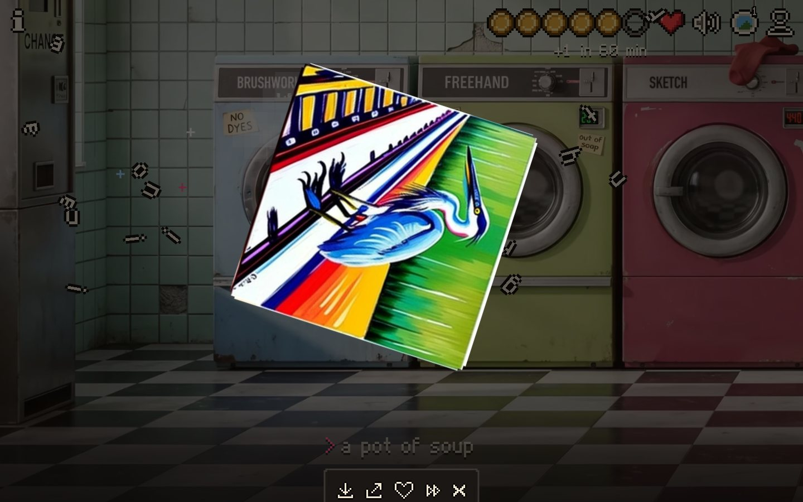

<div align="center">


# SIXFINGERS

A laundromat for prompts. You write one, pick a washing machine, and six pictures come out of the door.

**[sixfingers.vercel.app](https://sixfingers.vercel.app)**


</div>

## What it is

SIXFINGERS is a small website that makes pictures with AI image models. It is dressed as one wall of an old laundromat. There are seven machines, and each one runs a different model. You write a prompt on the floor (the sentence you give the model), drop a coin in a machine, and your words get pulled in and washed. When the machine beeps you hold the door until it bursts, and six pictures come out.

It's free and you don't sign up for anything. The pictures come from the [AI Horde](https://aihorde.net), a network of people who lend their graphics cards to strangers for free.

I'm Tristan Ulrich, a student in Paris, and I make it on my own.

## Why it exists

Image models are bad at hands. Ask one for a person waving and there is a fair chance the hand comes back with six fingers, or four, or a thumb on the wrong side. Stable Diffusion 1.5, the model behind the orange machine in the middle, was the first one that most people could run, and it gets the composition of a picture right while getting the anatomy wrong. That is where the name comes from. The sign on the wall says so too: "Not responsible for extra fingers."

A free model on volunteer computers can take a minute, sometimes several, and most sites cover that with a spinner. I wanted the wait to be the part you enjoy. A laundromat is a room built for waiting: you put something in, you watch it go round, and you get your things back a little changed. Words going into a machine and coming back as six pictures felt like a fair description of what these models do.

The first version of the site, from August to October 2026, was dressed as Windows XP, and six pictures arrived as a "pack" you opened by knocking on it. The laundromat replaced it on 12 October 2026.

## How a wash goes

**Pick a machine.** Clicking a machine walks you up to it. Its card says which model it runs, what that model is good at, and three numbers read from the Horde a moment ago: the estimated wait, how many jobs are in line, and how many volunteer computers are running it.


**Drop a coin.** The coin goes into the slot on the machine, the door swings open and the letters of your prompt fly in one at a time.


**Wait.** The drum is real physics: the letters have weight, they pile up and roll over each other, the three paddles lift them and drop them, and at the spin they get pressed flat against the wall like real laundry. The card shows the actual state of your job on the Horde: waiting in line, then painting, and each of the six squares fills in when a real picture is finished.


You don't have to stand there. Up to three machines can wash at once, one coin each, and you can walk between them; a machine that finishes while you're elsewhere lights up and beeps.

**Hold the door.** When the machine is done it stops shaking and glows. You press and hold on it, the pressure builds, and the door blows open.




**Six pictures come out,** one at a time. You can keep them, share them, or wash the same prompt in another machine.


Those six are a real wash on the Brushwork machine with the prompt "a heron waiting for a train". It took 87 seconds.

The collection keeps every wash with its prompt, its machine and its date. For now it lives in your browser. Optional accounts are on their way, so a collection can follow you from one device to another; the storage is set up (Supabase, hosted in Paris), and the sign-in options aren't open yet.


## The room changes with the time

The light coming into the room follows your own clock: daylight, sunset, and night with the neon doing most of the work.

<table>
<tr>
<td></td>
<td></td>
</tr>
</table>

It also works on a phone, where the prompt moves up above the keyboard and the machines are close enough to touch.

<table>
<tr>
<td></td>
<td></td>
</tr>
</table>

## The seven machines

From left to right on the wall. Each machine adds a "recipe" to your prompt: a few words of style, plus a list of things the picture should avoid. A machine doesn't have one fixed recipe. It has a small library sorted along a few axes (technique, light, colour), and for each wash every axis is shuffled like a deck of cards, so the six pictures each get a different combination and two washes of the same prompt don't come out alike.

| Machine | Model | What it does |
|---|---|---|
| Brushwork | Deliberate | Paints everything. Each picture gets its own technique (oil with thick impasto, watercolour, gouache, impressionist, Dutch golden age, acrylic), its own brushwork and its own palette. |
| Freehand | Anything Diffusion | A strong anime style that ignores half of what you type. The recipe moves between cel shading, manga panels, chibi and 1990s anime stills. |
| Sketch | Anything V5 | Pencil, ink and paper: graphite, pen, charcoal, ink wash, clean lineart. One picture in six keeps a little watercolour, because six black and white faces in a row felt grim. |
| Standard | Stable Diffusion 1.5 | No recipe at all. Your prompt goes in as you typed it. This is the model everything else here was built from, and the one with the most extra fingers. |
| High Gloss | Dreamshaper | The most capable and the least surprising. Concept art, glossy renders, storybook illustration, studio light. |
| Cinematic | AbsoluteReality | Every picture is a film still or a poster: its own shot, its own light (rim light, golden hour, a single hard lamp) and its own colour grade. |
| Photographic | ICBINP ("I Can't Believe It's Not Photography") | No recipe. It looks like a real camera took it, right up until you look at the hands. |

I picked the models with a stopwatch. On 12 October 2026 I sent the same prompt to eight models at the same time and kept the ones that came back in a reasonable time; two machines changed model that evening because almost nobody was running their old one.

## How the wait is estimated

Each machine has a small red display under its name. It shows how long a wash would take if you started it now. The fastest machines light up green, and a machine with no volunteer running its model is out of order.

The Horde publishes how much work is waiting and how fast that work gets done, both for each model and for the whole network. The work is counted in "megapixel-steps", roughly the size of a picture times the number of passes it takes to draw it. The estimate takes half of each:

```
model queue = work waiting for this model / speed of the computers running it
Horde queue = work waiting on the whole Horde / what the Horde gets through per minute
wait = (model queue + Horde queue) / 2 + 20 seconds
```

The model alone wasn't enough. On 13 October, High Gloss announced 30 seconds and took three minutes, because an anonymous visitor goes to the back of the line and the same computers also serve other models. Real washes correct the figure. After each one, the site records three numbers, anonymously: the machine, the wait it announced and the wait it really took. Each machine's estimate is then multiplied by the median ratio of the last 48 hours, measured across all visitors. Once you have washed twice on a machine, your own browser's ratio takes over for you.

The site reads the Horde again once a minute. During a wash, the time left counts down with the clock and adjusts as the queue moves, but it never jumps up by more than a tenth at once. The site never shows your place in the Horde's overall queue, because that counts every job on every model and made it look as if five hundred people were in front of you.

## What the site sticks to

When you aren't doing anything, nothing runs. An earlier version crashed my Mac twice by animating all the time, so the room now comes alive through spaced-out events (a car going by outside, a neon flicker), and the only loops that run every frame are the ones for a wash in progress, which stop when the letters settle. Everything goes to sleep when the tab is hidden, and less happens if your system asks for reduced motion.

Every number on the screen comes from a measurement. Volunteer counts, queue sizes and wait times come from the Horde. Wash times come from washes. If there's nothing reliable to show, the display stays blank.

Nothing is for sale, and there are no ads, trackers or scores. Coins exist to keep things fair for the volunteers: you start with six, one comes back every hour, and a wash that fails or that you stop gives its coin back. If you have your own Horde key, washing costs no coin.

Every picture you download carries a small visible "AI · SIXFINGERS" mark and the IPTC metadata that labels it as made by an AI model (`trainedAlgorithmicMedia`), as the EU AI Act asks.

To go easy on the volunteers, pictures are small (384 pixels, or 320 when a model has few computers behind it) and drawn in 10 to 14 steps. A wash is six separate requests, so different volunteers can paint them in parallel and you watch them arrive one by one.

## How it is built

It has no dependencies and no build step: plain JavaScript modules served as they are, and one stylesheet.

The room is one photograph of a laundromat that I generated with an image model and retouched area by area, 6336 by 3564 pixels. Day, sunset and night are relit copies of that same picture, and each copy is cut into layers: the wall without machines, each drum without its door, each door on its own hinge, and an out-of-order version of every machine. At rest each machine is exactly the background, pixel for pixel; when it shakes or the door opens, the layers underneath show. One CSS transform scales the whole room to your screen, so every coordinate in the code is a pixel of that one image.

Everything that isn't the room is drawn in code, in whole pixels: the windows, the buttons, the icons, the coins, the letters in the drum. There is one pixel unit for the whole interface, so nothing has bigger or finer pixels than its neighbour. The typeface is my own, written in the code as rows of `#` and `.`, and accents are drawn once and placed on the letter, so an "é" can't drift away from its "e".

The drum is a little physics simulation: gravity at the scale of a real 50 cm drum, a wall that drags the letters by friction, three paddles, letters that collide and stack and roll over each other, and a spin cycle fast enough to pin them to the wall. The machine's shaking comes from the load. When the letters sit off-centre it wobbles, and every drop gives it a small knock.

The sounds are synthesised by a script and only load after your first click. The radio in the corner plays six real stations and connects to nothing until you switch it on.

The site's code is private. The repository you're reading holds the parts that are meant to be open.

## What this repository is

This is the public side of SIXFINGERS. It holds no site code. It holds the catalogue of picture machines the site knows how to call, the rules a machine has to meet, the tools that check those rules, and the robots that answer proposals.

| Path | What's in it |
|---|---|
| `sources/` | The catalogue. Each machine is a small JSON record. `SCHEMA.md` explains every field in plain words. |
| `tools/check-source.py` | Checks a record against the same refusals the site applies. |
| `tools/cases.json` | 35 written records and whether each must be accepted. The python checker and the site's own checker are both held to this table. |
| `tools/words.py`, `words.json`, `words-cases.json`, `WORD-GUARD.md` | The word guard that keeps slurs out of public names, with a test table that is mostly real names it must leave alone. |
| `tools/read-proposal.py`, `proposal-cases.json` | Reads a proposal pasted into an issue and builds the record from it. |
| `.github/workflows/` | The robot that answers a proposal in about a minute, the check that runs on every pull request, and the one that writes `feed.json`. |
| `feed.json`, `moderation.json` | The feed of community machines and discussions, and a list that can only hide things from it. |
| `art/` | Pictures for this page and for links. |

Everything runs on the python3 that comes with macOS or Linux, with nothing to install:

```bash
python3 tools/check-source.py sources/*.json
python3 tools/check-cases.py
python3 tools/check-words.py
python3 tools/check-proposals.py
```

### Proposing a machine

The Horde runs well over a hundred image models, and every one of them is free and needs no key. The useful work here is deciding which ones are worth having and describing what they really do. A Horde machine is six lines:

```json
{
  "spec": 1,
  "kind": "horde",
  "id": "deliberate",
  "name": "Deliberate",
  "set": "Painterly",
  "model": "Deliberate",
  "note": "One sentence, on the object.",
  "what": "What comes back. Not what it promises.",
  "measured": { "on": "2026-08-26", "pack_seconds": 52.0 }
}
```

`measured` is optional and it's the most useful part. If you time a wash, write it down with the date.

[Propose one](../../issues/new?template=new-source.yml), or just [say something](../../discussions). You don't have to write the JSON yourself: the form asks the questions and the robot builds the record.

A record is data and never code. There is no field for a script or for an address to load, so there is nothing to run. Records that need a key, an account or a payment are refused, and so are addresses on your own network, redirects and plain `http`. Every image is redrawn in a canvas before it's kept. [`CONTRIBUTING.md`](CONTRIBUTING.md) has the details.

For now the laundromat ships its seven fixed machines. The community catalogue and the discussion wall were built for the Windows XP version and aren't plugged into the laundromat yet. They will come back once it has a back room for them.

## Thanks

To the volunteers of the [AI Horde](https://aihorde.net), who lend their graphics cards so that strangers can make pictures for free. Every picture on SIXFINGERS was painted on one of their machines. If you have a graphics card that sits idle, you can [lend it too](https://github.com/Haidra-Org/horde-worker-reGen).

To the people who trained and shared the seven models. Stable Diffusion 1.5 was developed by Robin Rombach and Patrick Esser. The Horde's pages for the other six don't name their authors, and I'd rather leave a blank than guess: Deliberate, Anything Diffusion, Anything V5, Dreamshaper, AbsoluteReality and ICBINP.

## Support

The site will stay free. If you'd like to help keep the machines running, you can leave a tip on [Ko-fi](https://ko-fi.com/tristanulrich). If tips ever add up, they'll pay for a computer that works for the Horde, so the site gives back some of what it uses.

## Contact

tristanulrichlobey@gmail.com, or open an [issue](../../issues).

## Licence

Copyright (c) 2026 Tristan Ulrich. All rights reserved.

SIXFINGERS is not open source. The site, its code, its artwork, its sounds, its typeface and its name are not licensed to anyone. This repository is public so that you can read the catalogue, run the checkers and propose a machine; [`LICENSE`](LICENSE) says exactly what that allows, and nothing beyond it.
